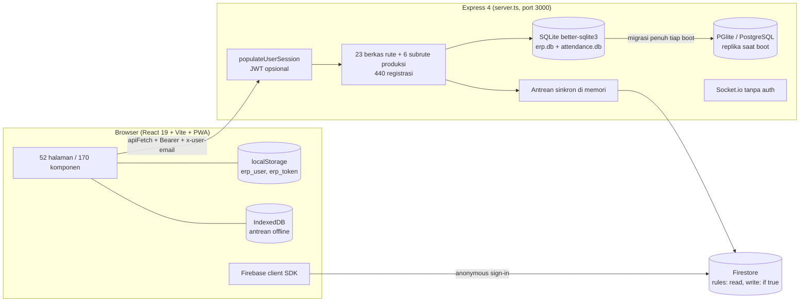

# Laporan Audit End-to-End FHTBS-ERP

**Objek audit:** repositori `eghyal/FHTBS-ERP`, *commit* `13bf2ae` ("feat: initialize FHTBS ERP system base structure")
**Tanggal audit:** 8 Oktober 2026
**Cakupan:** 337 berkas, 131.525 baris TypeScript/TSX di `src/`, 440 registrasi rute API, 52 halaman, 182 komponen TSX
**Metode:** analisis statis seluruh kode, pemetaan otomatis rute API ↔ pemanggilan *frontend*, `tsc --noEmit`, `vite build`, pengukuran kelas Tailwind dengan skrip, lalu verifikasi manual pada setiap temuan kritis.

---

## 0. Ringkasan Eksekutif

**Vonis: sistem ini belum layak dipakai untuk data bisnis sungguhan.** Fungsionalitasnya luas dan *build* berhasil, tetapi lapisan keamanan dan integritas data berlubang di tingkat fondasi. Beberapa lubang bisa dieksploitasi tanpa *login* sama sekali.

### Sepuluh temuan paling berbahaya

| # | Temuan | Dampak nyata |
|---|---|---|
| 1 | Akun FC (akses penuh) di-*seed* dengan kata sandi teks polos di kode publik: `admin/admin`, `Eghy/eghyalvandi`, `Ludy/bachtiarludy`. *Seed* dijalankan ulang **setiap server menyala** dan menimpa kata sandi. | Siapa pun yang membaca repo bisa masuk sebagai FC. Mengganti kata sandi tidak menolong karena di-*reset* saat *restart*. |
| 2 | `JWT_SECRET` punya nilai cadangan `"your_jwt_secret_key"` dan tidak tercantum di `.env.example`. | Jika variabel tidak diisi, siapa pun bisa memalsukan token untuk *username* mana pun. |
| 3 | Aturan Firestore `match /{document=**} { allow read, write: if true; }`. Kunci API Firebase ada di repo. Tabel `users` (berisi *hash*/teks polos kata sandi) dan `hr_salaries` disinkronkan ke sana. | Seluruh basis data *cloud* terbuka baca-tulis untuk publik. |
| 4 | 211 *endpoint* internal tanpa pemeriksaan autentikasi apa pun (116 di antaranya mengubah data), termasuk `/api/hr/salaries`, `/api/migration/start`, `/api/migration/mode`, `/api/upload`. | Data gaji bisa dibaca dan diubah anonim. Orang luar bisa memicu ekspor seluruh tabel ke Firestore publik. |
| 5 | PIN otorisasi harian dihitung di sisi klien, ditampilkan di menu, dan server menerima PIN universal `123456`, `654321`, `000000`, `888888`, `2024`. | Mekanisme "tanda tangan" untuk *void invoice*, pelunasan, *payroll*, dan GRN tidak punya nilai keamanan. |
| 6 | Identitas pengguna di 142 titik *backend* diambil dari *header* `x-user-email` yang dikirim klien. | Jejak audit, absensi (*clock-in*), dan validasi PIN bisa dipalsukan atas nama orang lain. |
| 7 | Toko daring: pesanan non-COD langsung berstatus `PAID` saat *checkout* tanpa verifikasi; *endpoint* publik `confirm-payment` juga langsung men-set `PAID`. Kuantitas dan jarak kirim negatif diterima. | Barang bisa diproses tanpa uang masuk; total tagihan bisa dibuat negatif. |
| 8 | Pelunasan *invoice* tidak menolak *invoice* yang sudah `PAID`/`VOID`, tidak membatasi jumlah bayar, dan mencatat kas sebesar porsi DPP, bukan uang yang diterima. | Kelebihan bayar, kas tercatat lebih kecil dari kenyataan, PPN hilang dari arus kas. |
| 9 | Buku besar (GL) hanya menerima jurnal otomatis dari dua jalur: penyesuaian stok v2 dan penjualan ritel cepat (yang bahkan tidak dipanggil UI). GRN, surat jalan, *invoice*, pelunasan, pembayaran PO, dan *payroll* tidak menjurnal. | Neraca saldo dan laporan keuangan dari modul GL tidak mencerminkan transaksi. |
| 10 | Tabel `inventory` punya lima kolom stok yang tumpang-tindih; 19 perintah `UPDATE inventory` memakai **11 kombinasi kolom berbeda**. | Angka stok fisik, bebas, teralokasi, dan tersedia pasti bergeser satu sama lain seiring waktu. |

### Angka kunci

| Indikator | Nilai |
|---|---|
| Registrasi rute API | 440 |
| Rute internal tanpa *guard* | **211** (116 mutasi) |
| Rute yang memakai validasi Zod | 9 (2%) |
| Pemanggilan *frontend* ke *endpoint* yang tidak ada | 8 titik di halaman aktif + 5 di kode mati |
| Kandidat *endpoint* yatim (tidak dipanggil UI) | ±121 |
| Rute ganda (metode + jalur sama) | 4 |
| Pesan *error* internal bocor ke klien | 164 titik |
| Adopsi komponen UI: Button / Input / Select / Textarea / Table / Card | 39% / 26% / 25% / 0% / 7% / 6% |
| Ukuran teks *arbitrary* (`text-[Npx]`) | 2.504 pemakaian, 16 ukuran berbeda, terkecil 7px |
| Warna merek ditulis sebagai *hex* mentah `#b02524` | 336 kali; token merek `--color-paving-red` dipakai 0 kali |

### Satu solusi yang direkomendasikan

Setelah enam strategi diuji (Bagian D), hasil konvergensinya adalah:

> **Program "Kunci-Satukan-Standarkan": pengerasan keamanan 72 jam pertama, lalu modularisasi bertahap dengan pola *strangler* di belakang satu gerbang otorisasi *deny-by-default*, satu jalur tulis untuk stok dan jurnal, satu sumber data, dan satu sistem desain berbasis token.**

Tidak menulis ulang dari nol, tidak menambal satu per satu tanpa arah, dan tidak pindah ke ERP lain.

---

## 1. Peta Sistem

**Catatan arsitektur:**
- Ada **empat penyimpanan data** yang berjalan bersamaan: SQLite (sumber utama), Firestore (cermin *cloud* dengan mode `DUAL/FIRESTORE_ONLY/SQLITE_FALLBACK`), PGlite/PostgreSQL (replika penuh yang dibangun ulang setiap *boot*), dan Dexie/IndexedDB di klien. Skema Drizzle (`src/db/schema.ts`) hanya berisi satu tabel `users` yang tidak sesuai dengan skema SQLite.
- Pola lapisan *repository → service* hanya diterapkan pada inventori, keuangan, dan data induk. Sisanya berupa *handler* gemuk: `projects.ts` 3.921 baris, `execution_routes.ts` 3.682 baris, `sales.ts` 3.614 baris.
- Skema dibangun lewat `initDb()` dengan 410 pernyataan `ALTER TABLE` tanpa versi migrasi.

---

## 2. Bagian A — Audit Logika, API, dan Alur

### A1. Autentikasi dan Otorisasi

#### A1.1 Kredensial teks polos yang di-*reset* setiap *boot* — **KRITIS**
- `src/db/database.ts:2482–2516` menjalankan `INSERT ... ON CONFLICT(username) DO UPDATE SET password = excluded.password` untuk `Eghy`, `Ludy`, dan `admin`, semuanya `role = FC`, `status = APPROVED`. Blok ini ada di dalam `initDb()` yang dipanggil `server.ts` setiap kali server menyala.
- `seedMasterBaseline()` (`database.ts:2640–2648`) mengulang hal yang sama dengan `INSERT OR REPLACE`, juga dipanggil saat *factory reset*.
- `auth_routes.ts:34` menerima kata sandi teks polos ("*backward compatibility*"), sehingga *seed* teks polos itu langsung bisa dipakai masuk.
- Repositori bersifat publik. **Ketiga kredensial ini harus dianggap sudah bocor.**

#### A1.2 Rahasia JWT cadangan — **KRITIS (bersyarat)**
- `middleware/auth.ts:5` dan `routes/auth_routes.ts:2`: `process.env.JWT_SECRET || "your_jwt_secret_key"`.
- `.env.example` tidak menyebut `JWT_SECRET`. Bila *deployment* tidak mengisinya, token FC bisa ditempa dengan satu baris kode.

#### A1.3 Cakupan *guard* — **KRITIS**
Dari 440 registrasi rute:

| Status | Jumlah |
|---|---|
| Memakai `requireRole` | 194 |
| Publik yang memang wajar (toko, karier, *login*, *register*, CMS) | 19 |
| Hanya mengecek identitas dari *header* di dalam *handler* | 16 |
| **Internal tanpa pemeriksaan apa pun** | **211** |

Subrute produksi (`bop`, `execution`, `manpower`, `ndp`, `planning`, `analytics`) paling parah: 124 dari 128 rutenya tanpa *guard*. Contoh yang paling berbahaya:

| Endpoint | Masalah |
|---|---|
| `GET/POST /api/hr/salaries` (`hr.ts:11, 21`) | Baca dan ubah gaji tanpa *login* |
| `POST /api/migration/start`, `/api/postgres/migrate`, `/api/migration/mode` | Memicu ekspor `SELECT *` seluruh tabel (termasuk `users`) ke Firestore publik; mengganti mode basis data ke `FIRESTORE_ONLY` |
| `POST /api/upload`, `/api/upload/base64` | Unggah tanpa *login*, tanpa filter tipe; ekstensi asli dipertahankan dan disajikan dari *origin* yang sama lewat `/uploads` |
| `GET /api/hr/applications` | Daftar seluruh pelamar beserta email, telepon, dan riwayat kerja terbuka untuk publik |
| `POST /api/hr/jobs`, `PUT /api/hr/applications/:id/status`, `PUT /api/hr/leaves/:id/status` | Membuat lowongan, meluluskan pelamar, menyetujui cuti tanpa *login* |
| `DELETE /api/chat/threads/:id` | Hanya mengecek *header* `x-user-email`, tanpa cek kepemilikan → siapa pun bisa menghapus percakapan mana pun cukup dengan *header* palsu |
| `POST /api/production/projects/:id/finish-and-inbound` | Menutup proyek dan memasukkan barang jadi ke gudang |
| `POST /api/production/manpower/reset-defaults` | Mengembalikan data tenaga kerja ke bawaan |

**Rantai serangan yang realistis:** unggah berkas `.html` lewat `/api/upload` → berkas disajikan dari *origin* aplikasi → skrip membaca `localStorage.erp_token` → token FC dicuri.

#### A1.4 Identitas dari *header* klien — **TINGGI**
- 142 titik di *backend* membaca `req.headers["x-user-email"]`, `x-user-id`, atau `x-forwarded-user`; `apiFetch` mengirim *header* ini dari `localStorage`.
- *Clock-in* absensi (`hr-attendance.ts:270`) memakai `x-user-email || req.body.employee_username` → titip absen atau absen atas nama orang lain sangat mudah.
- Validasi PIN di `finance.ts` dan `sales.ts` juga memakai *header* ini, bukan `req.user`.

#### A1.5 PIN otorisasi harian — **TINGGI**
- `utils/auth.ts:42–48` menerima lima PIN universal. Algoritma PIN deterministik dari *username* + tanggal dan ikut dikirim ke *browser*; `Layout.tsx:1109` bahkan menampilkannya dengan tombol salin.
- Ada juga "PIN generik admin" yang berlaku untuk semua orang (`utils/auth.ts`, baris `getDailyAuthKeyForDate("admin", d)`).
- Di beberapa halaman, PIN hanya dicek di klien lalu tidak dikirim ke server, misalnya otorisasi surat jalan (`Deliveries.tsx:372–381`). `HumanResource.tsx:772–842` mengisi PIN secara otomatis.

#### A1.6 Taksonomi peran yang tidak sinkron — **TINGGI**
- *Frontend* (`AuthContext.tsx`) hanya mengenal `FC, ENGINEERING, PURCHASING, WAREHOUSE, PRODUCTION, SALES, HR`.
- *Backend* memakai tambahan `ADMIN` (65 kali), `BOD` (29), `GOD_MODE` (23), `SUPERADMIN` (13), `DIRECTOR` (4), `SUPER_ADMIN` (3). `requireRole` hanya menganggap `FC, BOD, DIRECTOR, SUPERADMIN, ADMIN` sebagai eksekutif — `SUPER_ADMIN` dan `GOD_MODE` tidak.
- *God mode* di klien ditentukan oleh *username* (`pbac.ts:62`: `["eghy", "ludy"]`), di server tidak.
- Penukaran token *onboarding* (`hr.ts:590`) memberi peran **FC** kepada setiap karyawan baru dari departemen yang mengandung kata "FIN". Peran `STAFF` untuk departemen lain tidak ada di kebijakan klien sehingga pengguna itu tidak punya izin apa pun.
- Pendaftaran (`/api/auth/register`) membiarkan pendaftar memilih perannya sendiri, termasuk FC; hanya ditahan oleh persetujuan manual.

#### A1.7 Sesi dan logout — **SEDANG**
- `AuthContext.tsx:79` hanya *logout* saat 401 bila `erp_user` **tidak** ada di `localStorage`, padahal saat pengguna sedang masuk nilai itu selalu ada. Akibatnya, setelah JWT kedaluwarsa (24 jam), UI tetap tampak masuk tetapi semua rute ber-*guard* gagal.
- Tidak ada pemeriksaan sesi saat aplikasi dibuka; objek pengguna diambil apa adanya dari `localStorage` (bisa diedit untuk membuka menu).
- `/api/users/logout` mengambil *username* dari *header*/*body*, sehingga siapa pun bisa "mengeluarkan" orang lain dari status *online*.
- *Login* membandingkan *username* secara peka huruf, *middleware* memakai `COLLATE NOCASE`.

#### A1.8 Pengerasan HTTP yang absen — **SEDANG**
- `helmet`, `compression`, dan `express-rate-limit` ada di `package.json` tetapi tidak dipasang.
- `cors()` terbuka untuk semua *origin*; Socket.io `cors: "*"` tanpa autentikasi.
- `express.json({ limit: '50mb' })` untuk semua rute.
- Tidak ada *error handler* global; 164 respons mengirim `error.message` mentah ke klien.
- *Login* tanpa pembatas percobaan.

### A2. Integritas Data dan Alur Bisnis

#### A2.1 Firestore publik dan sinkronisasi — **KRITIS**
- `firestore.rules:28–30`: aturan *wildcard* `allow read, write: if true` menimpa semua aturan spesifik di bawahnya. Klien melakukan `signInAnonymously`, sehingga aturan berbasis peran pun tidak akan berfungsi.
- `migrationEngine.ts:169` mengirim `SELECT * FROM "<tabel>"` untuk 50+ tabel, termasuk `users` dan `hr_salaries`.
- `firebaseSync.ts` memakai SDK klien di server dengan antrean di memori: data yang belum terkirim hilang bila proses mati.
- Fungsi `rehydrateLocalFromCloudFirestore` (saat ini tidak dipanggil) akan menyalin dokumen `users` dari Firestore publik ke SQLite. Bila suatu hari diaktifkan, siapa pun bisa menanam akun FC.
- `syncCollectionToFirestore` dipanggil **di dalam** `db.transaction`, jadi bila transaksi gagal, data yang belum *commit* tetap terkirim ke *cloud*.

#### A2.2 Stok — **TINGGI**
- Lima kolom stok: `physical_qty`, `free_stock`, `allocated_stock`, `reserved_qty`, `available_qty`. Pasangan `free_stock`/`available_qty` dan `allocated_stock`/`reserved_qty` bermakna sama.
- 19 `UPDATE inventory` memakai 11 kombinasi kolom. Contoh: konsumsi di `purchasing.ts:2272` hanya mengurangi `free_stock`; penyesuaian "ADD" mengubah tiga kolom; alokasi WO (`execution_routes.ts:243`) mengubah empat kolom.
- Tidak ada `CHECK (kolom >= 0)` di skema.
- Ada **empat** jalur penyesuaian stok: `/api/inventory/adjust` (didaftarkan dua kali — *handler* kedua di `inventory.ts:1127` tidak pernah tercapai), `/api/inventory/adjustments`, dan `/api/inventory/adjust-v2`. UI hanya memakai `adjust-v2`.
- `POST /api/inventory/reset` mengenolkan seluruh stok; cukup peran `WAREHOUSE`.

#### A2.3 Buku besar dan keuangan — **TINGGI**
- Dua pencatatan keuangan yang tidak saling terhubung: `finance_transactions` (basis kas) dan `journal_entries` (*double-entry*).
- Penjurnalan otomatis hanya terjadi pada `MANUAL_ADJUSTMENT` (`inventory.ts:1494`) dan `INVOICE_PAYMENT` pada penjualan ritel cepat (`sales.ts:1822`). *Endpoint* ritel cepat itu tidak dipanggil dari UI mana pun.
- Pada penjualan ritel, kegagalan posting jurnal ditelan (`sales.ts:1829`: `console.warn`). Penjualan tetap tercatat walau periode akuntansi sudah dikunci.
- Dua implementasi validasi jurnal dengan toleransi berbeda: `accountingBridge.ts` (selisih > 1) dan `financeService.ts` (selisih > 0,01).

#### A2.4 Pelunasan *invoice* — **TINGGI** (`finance.ts:549`)
- Tidak ada penolakan untuk *invoice* `PAID` atau `VOID`.
- `amount` bebas; `amount_paid` bisa melebihi tagihan.
- Kas masuk dicatat `netRevenue = payAmount × DPP/total`, bukan uang yang benar-benar diterima.
- Tarif PPN diasumsikan 12% bila kosong; `paid_at` ditimpa setiap pembayaran parsial.

#### A2.5 Toko daring — **KRITIS** (`shop.ts`)
- `shop.ts:286–289`: status awal `PAID`/`DP_PAID` untuk semua metode non-COD, walaupun `payment_proof_url` kosong. Pesanan langsung `PROCESSING`.
- `confirm-payment` (`shop.ts:929`) publik dan langsung men-set `PAID`.
- `qty` negatif atau pecahan diterima (`Number(line.qty) || 1`); `delivery_distance` dari klien menentukan ongkir dan boleh negatif; `dp_amount` bebas.
- `delivery_address.trim()` tanpa validasi → *error* 500 bila kosong.
- *Checkout* menambah `reserved_qty` tanpa memeriksa ketersediaan, sementara `available_qty` dipotong dengan `MAX(0, …)` (`shop.ts` ±baris 354). Pesanan melebihi stok tidak terdeteksi, dan qty negatif justru menambah stok tersedia.

#### A2.6 Persetujuan pembelian — **TINGGI**
- `authorize-po` (`purchasing.ts:2059`) tidak memeriksa status PO; PO yang sudah `CANCELLED` bisa diterbitkan ulang.
- Matriks persetujuan berbasis nilai (`workflow_matrices`: Direktur untuk PO > Rp50 juta) disimpan dan bisa diatur di halaman Workflow, tetapi **tidak pernah dibaca** oleh modul pembelian. Halaman itu dekoratif.

#### A2.7 Antrean *offline* — **SEDANG**
- `useOfflineSyncStore.ts` memutar ulang permintaan tanpa kunci idempotensi. Permintaan yang *timeout* (15 detik) bisa sudah sukses di server, lalu dikirim lagi → log produksi atau mutasi stok ganda.
- Respons 4xx dimasukkan kembali ke antrean selamanya.
- `apiFetch` mengulang permintaan non-GET saat 429.
- `src/lib/idempotency.ts` sudah ditulis tetapi tidak dipakai di mana pun.

#### A2.8 Lain-lain
- 126 ID dibuat dengan `Math.random().toString(36)`, 68 dengan `randomUUID`; pola prefiks tidak seragam.
- Penanda baca pesan memakai `read_by LIKE '%' || username || '%'` → pengguna `ali` dianggap sudah membaca pesan untuk `alice`.
- Konstanta regulasi (batas upah BPJS, tarif TER PPh 21, PPN 12%/11/12) ditulis langsung di kode.

### A3. Kontrak API *Frontend* ↔ *Backend*

#### A3.1 Pemanggilan ke *endpoint* yang tidak ada — **TINGGI**

| Lokasi | URL | Akibat di layar |
|---|---|---|
| `ProjectProductionHub.tsx:295` | `/api/production/projects/:id/lots` | 404 di setiap muat; data lot kosong |
| `ProjectProductionHub.tsx:299` | `/api/production/projects/:id/wot-eta` | 404; ETA tidak pernah tampil |
| `ProductionCapacityOptimizerModal.tsx:220–221` | `.../wot-cpm`, `.../gap-analysis` | Analisis CPM dan *gap* selalu kosong |
| `Requests.tsx:210` | `/api/production/project/:id/bop-steps` | Langkah BOP tidak termuat |
| `Production.tsx:109` | `/api/project-tasks` | Data tugas di hub produksi kosong |
| `NdpResolveModal.tsx:39`, `NdpTriggerModal.tsx:58` | `/api/inventory/items?type=MACHINE` | Opsi "ganti mesin" selalu tanpa pilihan |

Kegagalan ini senyap karena `Promise.all` + `apiFetch` mengembalikan `{ok:false}` tanpa *error*. Lima pemanggilan lain ada di `services/salesService.ts`, `productionService.ts`, `purchasingService.ts`, yang seluruhnya kode mati.

#### A3.2 Rute ganda dan alias
- Didaftarkan dua kali: `POST /api/inventory/adjust`, `GET /api/hr/attendances`, `GET /api/production/ndp`, `GET /api/purchasing/suppliers-by-items`. Hanya yang pertama berlaku.
- Alias paralel yang menggandakan permukaan API: `/api/ndps/*` ↔ `/api/production/ndp/*`, `/api/customers` ↔ `/api/sales/customers`, `/api/quotations` ↔ `/api/sales/quotations`, `PATCH`+`POST` untuk setiap aksi *floor request*.

#### A3.3 *Endpoint* yatim
±121 rute tidak ditemukan pemanggilnya di UI (angka heuristik; sebagian dipanggil lewat URL dinamis). Yang pasti yatim: seluruh `/api/forum/*` (halaman Forum memakai `/api/chat`), `/api/sales/orders/quick-settle`, tiga varian penyesuaian stok lama, `/api/finance/journal-entries`, `/api/work-orders/*`, `/api/sync/outbox/*`, `/api/system/cache-*`.

#### A3.4 Validasi masukan
Hanya 9 dari 440 rute memakai `validateBody`/`validateQuery`. Selebihnya membaca `req.body` langsung, dengan pola `Number(x) || 0` yang mengubah masukan tidak valid menjadi nol diam-diam.

### A4. Arsitektur dan Kualitas Kode
- 850 `as any`; `tsconfig` tanpa `strict`. `tsc` hanya melaporkan 9 kesalahan (semuanya di `mascotStore.ts`) karena pemeriksaan longgar.
- Dua folder utilitas yang tumpang-tindih: `src/lib/` dan `src/utils/`.
- 336 `console.error` sebagai satu-satunya pencatatan; tidak ada *logger* terstruktur.
- Satu berkas uji (`src/tests/comprehensive_audit_test.ts`) tanpa *test runner* di `package.json`; tidak ada CI.

### A5. *Build* dan Operasional
- `package-lock.json` tidak sinkron dengan `package.json` (`zod@4.6.5`, `@electric-sql/pglite@0.5.8` hilang) → `npm ci` gagal; *build* tidak reprodusibel.
- *Script* `start` menjalankan `node server.ts`; hanya berjalan di Node yang mendukung *type stripping*.
- `build` dan `postbuild` sama-sama menyalin `dist` → `build`.
- Hasil *build*: *chunk* utama 609 KB (193 KB gzip), `vendor-pdf` 640 KB, `vendor-firebase` 531 KB. PWA melakukan *precache* 162 berkas (6,2 MB) — semua modul ERP diunduh ke ponsel operator walau tidak dipakai.
- Setiap *boot* menjalankan migrasi penuh ke PGlite/PostgreSQL di latar.

### A6. Yang Sudah Baik
Agar perbaikan tidak membuang yang sudah benar:
- SQL hampir seluruhnya ber-parameter; interpolasi hanya untuk *placeholder* dan nama kolom dari daftar tetap. Tidak ditemukan *SQL injection* langsung dari masukan pengguna.
- 97 blok `db.transaction` dan pola `WHERE free_stock >= ?` untuk mencegah stok minus di beberapa jalur.
- `postJournalEntry` sudah memeriksa keseimbangan debit-kredit dan kunci periode.
- *Lazy loading* per halaman, *chunking vendor*, PWA, dan *build* lulus.
- Komponen `Modal` sudah dipakai di 56 dari 68 berkas modal.

---

## 3. Bagian B — Audit UI/UX dan *Micro-Component*

### B1. Adopsi Komponen Dasar

Pustaka `src/components/ui/` sudah ada (12 komponen, 991 baris), tetapi mayoritas layar tidak memakainya.

| Komponen | Versi pustaka | Ditulis manual | Adopsi |
|---|---:|---:|---:|
| Button | 338 | 539 `<button>` | 39% |
| Input | 81 | 225 `<input>` | 26% |
| Select | 25 | 74 `<select>` | 25% |
| Textarea | 0 | 52 `<textarea>` | **0%** |
| Table | 6 | 80 `<table>` | **7%** |
| Card | 15 | ±246 pola kartu manual | **6%** |
| Modal | 56 berkas | 10 berkas modal + 7 berkas lain dengan *overlay* `fixed inset-0` buatan sendiri | 82% |
| FormField | 0 | — | 0% |
| StatCard | 0 | — | 0% |
| Badge | 6 berkas | ≥158 *badge* inline (`bg-X-50 text-X-700 rounded`) | rendah |
| EmptyState | 3 berkas | — | rendah |
| PageHeader | 30 dari 52 halaman | — | 58% |

Penyumbang `<button>` manual terbanyak: `BopEngineeringEditor.tsx` (33), `HumanResource.tsx` (27), `ShopManagement.tsx` (19), `LogTable.tsx` (15). Modal buatan sendiri terkonsentrasi di modul toko (`CartDrawer`, `CheckoutModal`, `ProductDetailModal`, `OrderSuccessModal`, `OrderTrackingModal`) dan *lead scouting*.

**Duplikasi fungsi format:** ada lima fungsi format rupiah yang berbeda (`formatCurrency` dan `formatIDR` di `lib/utils.ts`, `formatRupiah` di `utils/format.ts`, plus salinan lokal di `HumanResource.tsx`, `EmployeeSelfService.tsx`, `PayrollSalarySettings.tsx`, `ProjectHppModal.tsx`) dan 360 pemanggilan `toLocaleString`/`Intl.NumberFormat` langsung.

### B2. Palet Warna

| Peran | Keluarga yang dipakai | Masalah |
|---|---|---|
| Netral | `stone` 9.952, `slate` 598, `gray` 2 | Dua nada abu-abu berbeda bercampur |
| Bahaya | `rose` 738, `red` 257 | Dua merah untuk satu makna |
| Sukses | `emerald` 1.323, `green` 1 | — |
| Info | `blue` 460, `indigo` 143, `sky` 15, `violet` 18, `purple` 91 | Lima biru-ungu tanpa aturan |
| Merek | `#b02524` 336 kali, `#961f1e` 29 kali; token `--color-paving-red: #B22222` | Token merek tidak pernah dipakai; nilainya pun berbeda dari *hex* yang dipakai |

Total ada 121 kode *hex* berbeda di kode sumber. Latar halaman memakai empat putih berbeda: `#FDFDFD`, `#faf9f6`, `#F5F5F4`, dan `stone-50`. Ada 518 kelas `dark:` di 12 berkas, tetapi tidak ada mekanisme untuk mengaktifkan mode gelap — kode mati.

### B3. Tipografi
- 2.504 ukuran teks *arbitrary*: `text-[10px]` 1.425 kali, `text-[9px]` 397, `text-[11px]` 440, `text-[8px]` 131, `text-[7px]` 41, plus 7,5 / 8,5 / 9,5 / 10,5px. Teks 7–9px tidak terbaca di layar *shop floor* dan melanggar batas keterbacaan.
- Bobot huruf didominasi `font-bold` (2.744) dan `font-black` (767), sehingga hierarki visual hilang karena semua tebal.
- `tracking` memakai 10 nilai, termasuk empat nilai *arbitrary* (`[0.1em]`–`[0.3em]`).

### B4. Jarak, Radius, Bayangan, Lapisan
- 27 nilai *padding* berbeda, termasuk 2,5 / 3,5 / 4,5 / 7 dan satuan `cqi`/`mm`.
- Ritme vertikal halaman tidak seragam: `space-y-5/6/8/10/12` dengan `pb-12/16/20/24`.
- 19 nilai radius, termasuk tujuh nilai *arbitrary* (`[1.25rem]` sampai `[5rem]`). Modal memakai `rounded-[2rem]`, kartu `rounded-2xl`/`3xl`, tombol `rounded-xl`.
- 14 nilai `z-index` dari `0` sampai `[99999]`. Modal ada di `z-[200]`, sehingga elemen `z-[9999]`/`[99999]` dapat menutupi modal.
- 3.637 nilai *arbitrary* Tailwind secara keseluruhan.

### B5. CSS Global yang Bertabrakan dengan Komponen
`src/index.css` memberi gaya langsung pada elemen HTML:
- Baris 98–115: semua `input`, `textarea`, `select` mendapat *padding*, *border*, dan radius sendiri. Komponen `Input` ikut terkena, dan pengembang harus menambahkan `.no-base-style` untuk lolos.
- Baris 128–144: `button.bg-stone-900` mendapat `letter-spacing`, `font-weight: 700`, bayangan, dan animasi naik saat *hover*. Varian `primary` di `Button.tsx` memakai `bg-stone-900`, jadi tombol utama berperilaku berbeda dari definisinya sendiri.
- Baris 146 dst.: `table`, `th`, `td` diberi *padding* 14px/20px dan teks 11px/14px, berbenturan dengan `Table.tsx` yang memakai `text-xs sm:text-sm`.

Akibatnya, tampilan komponen bergantung pada urutan dan spesifisitas CSS, bukan pada komponennya.

### B6. *Responsiveness*
- 68 dari 182 berkas TSX tidak punya satu pun *breakpoint* (`sm:`/`md:`/`lg:`).
- 164 lebar piksel tetap (`w-[Npx]`/`min-w-[Npx]`).
- 42 dari 80 `<table>` manual tidak dibungkus wadah `overflow-x-auto` (sebagian adalah pratinjau dokumen cetak, tetapi termasuk tabel utama di `Invoices.tsx`, `Deliveries.tsx`, `Payroll.tsx`, `Quotations.tsx`, `ShopManagement.tsx`). Di ponsel, tabel ini melebar ke luar layar.

### B7. Aksesibilitas
- `Modal` tidak punya `role="dialog"`, `aria-modal`, penutupan dengan tombol Esc, maupun penahan fokus.
- `outline-none` dipakai 226 kali, `focus-visible` hanya 11 kali → navigasi papan ketik tidak terlihat.
- Hanya 37 `aria-label`; tombol ikon mengandalkan `title`.
- `<html lang="en">` walaupun antarmuka berbahasa Indonesia.

### B8. Bahasa Antarmuka
Label aksi bercampur: "Add"/"Tambah", "Save"/"Simpan", "Submit"/"Kirim". `LanguageContext` hanya dipakai 23 dari 182 berkas. Pesan *error* *backend* juga bercampur Inggris-Indonesia.

---

## 4. Bagian C — Daftar Kesalahan dan *Gap*

Skala: **K** = kritis (bisa dieksploitasi atau merusak data keuangan sekarang), **T** = tinggi, **S** = sedang, **R** = rendah.

| ID | Sev. | Area | Masalah | Bukti |
|---|---|---|---|---|
| G-01 | K | Auth | Kredensial FC teks polos di repo publik, di-*reset* tiap *boot* | `database.ts:2482–2516, 2640–2648` |
| G-02 | K | Auth | Rahasia JWT cadangan yang diketahui umum | `middleware/auth.ts:5` |
| G-03 | K | Data | Firestore baca-tulis publik; tabel `users` dan gaji ikut tersinkron | `firestore.rules:28–30`, `migrationEngine.ts:169` |
| G-04 | K | Auth | 211 rute internal tanpa *guard*, termasuk gaji dan migrasi | Lampiran 1 |
| G-05 | K | Keamanan | Unggah anonim tanpa filter tipe, disajikan dari *origin* yang sama; token di `localStorage` | `upload_routes.ts:108,162`, `server.ts` |
| G-06 | K | Bisnis | Pesanan toko otomatis `PAID`; konfirmasi bayar publik; qty/jarak negatif | `shop.ts:286, 929` |
| G-07 | T | Auth | PIN harian: PIN universal, dihitung di klien, sebagian hanya dicek di klien | `utils/auth.ts:42`, `Deliveries.tsx:372` |
| G-08 | T | Auth | Identitas dari *header* `x-user-email` (142 titik), termasuk absensi | `hr-attendance.ts:270` |
| G-09 | T | Auth | Taksonomi peran tak sinkron; karyawan "FIN" otomatis FC; pendaftar memilih peran | `hr.ts:590`, `pbac.ts:62` |
| G-10 | T | Keuangan | Pelunasan *invoice* tanpa cek status/sisa; kas dicatat sebesar DPP | `finance.ts:549` |
| G-11 | T | Keuangan | GL tidak menerima jurnal dari GRN, SJ, *invoice*, pelunasan, PO, *payroll* | `accountingBridge.ts`, A2.3 |
| G-12 | T | Stok | 5 kolom stok, 11 pola pembaruan, tanpa batas non-negatif | A2.2 |
| G-13 | T | Pembelian | Matriks persetujuan tidak ditegakkan; PO batal bisa diterbitkan | `purchasing.ts:2059` |
| G-14 | T | API | 8 pemanggilan UI ke *endpoint* yang tidak ada (gagal senyap) | A3.1 |
| G-15 | T | Data | Empat penyimpanan data paralel; sinkron *cloud* di dalam transaksi | A2.1 |
| G-16 | S | Sesi | JWT kedaluwarsa tidak memicu *logout*; sesi tidak divalidasi saat buka | `AuthContext.tsx:79` |
| G-17 | S | HTTP | Tanpa helmet, *rate limit*, CORS terbatas, *error handler*; 164 kebocoran pesan *error* | `server.ts` |
| G-18 | S | Offline | Pemutaran ulang tanpa idempotensi; 4xx berulang tanpa akhir | `useOfflineSyncStore.ts` |
| G-19 | S | API | 4 rute ganda, alias paralel, ±121 *endpoint* yatim, 9/440 rute tervalidasi | A3.2–A3.4 |
| G-20 | S | Build | *Lockfile* tidak sinkron; *precache* PWA 6,2 MB | A5 |
| G-21 | T | UI | Adopsi komponen rendah (Table 7%, Textarea 0%, Card 6%) | B1 |
| G-22 | T | UI | CSS global menimpa komponen (input, tabel, tombol primer) | `index.css:98–180` |
| G-23 | S | UI | Palet tanpa token: 121 *hex*, dua netral, dua merah bahaya, merek tidak ditokenkan | B2 |
| G-24 | S | UI | 2.504 ukuran teks *arbitrary*, hingga 7px | B3 |
| G-25 | S | UI | Tabel tanpa gulir horizontal; 68 berkas tanpa *breakpoint* | B6 |
| G-26 | S | UI | Modal tidak aksesibel; fokus tidak terlihat | B7 |
| G-27 | R | UI | 518 kelas `dark:` mati; bahasa label bercampur; 5 fungsi format rupiah | B2, B8, B1 |
| G-28 | R | Kode | 850 `as any`, tanpa `strict`, tanpa uji dan CI | A4 |

---

## 5. Bagian D — Analisis Perbaikan dengan Model Divergen-Konvergen

### D1. Cara kerja model

1. **Divergen** — kumpulkan sebanyak mungkin strategi tanpa menyaring dulu.
2. **Kriteria** — tetapkan ukuran yang mewakili kepentingan bisnis, beri bobot.
3. **Konvergen** — nilai setiap strategi, gugurkan yang lemah, gabungkan kekuatan yang tersisa menjadi satu solusi.
4. **Turunkan** — lakukan siklus divergen-konvergen kecil untuk setiap klaster masalah di dalam solusi terpilih.

### D2. Divergen — enam strategi besar

| Kode | Strategi | Gambaran singkat |
|---|---|---|
| S1 | Tambal reaktif | Perbaiki temuan satu per satu sesuai urutan keparahan, tanpa mengubah struktur |
| S2 | Tulis ulang total | Bangun ulang dengan arsitektur baru, sistem lama dibekukan |
| S3 | Pindah ke ERP siap pakai | Odoo/ERPNext + kustomisasi modul produksi paving |
| S4 | Pengerasan dulu, lalu modularisasi bertahap (*strangler*) + sistem desain | Tutup lubang kritis dalam hitungan hari, lalu ganti bagian demi bagian di belakang antarmuka yang stabil |
| S5 | *Big-bang refactor* | Bekukan fitur, refaktor besar di cabang terpisah, gabung sekaligus |
| S6 | Perisai luar | Pasang API *gateway*/*reverse proxy* dengan autentikasi di depan aplikasi, kode tidak disentuh |

### D3. Kriteria dan bobot

| Kriteria | Bobot | Alasan |
|---|---:|---|
| K1. Kecepatan menurunkan risiko kritis | 30% | G-01 s.d. G-06 bisa dieksploitasi hari ini |
| K2. Kontinuitas operasi pabrik dan toko | 20% | Produksi dan penjualan tidak boleh berhenti |
| K3. Biaya dan tenaga | 15% | Tim kecil |
| K4. Kesesuaian dengan proses bisnis yang sudah dimodelkan | 15% | WOT, BOP, NDP, HPP sudah spesifik usaha paving |
| K5. Keberlanjutan jangka panjang | 20% | Mencegah masalah yang sama berulang |

### D4. Konvergen — penilaian (skala 1–5)

| Strategi | K1 (30%) | K2 (20%) | K3 (15%) | K4 (15%) | K5 (20%) | **Skor** |
|---|---:|---:|---:|---:|---:|---:|
| S1 Tambal reaktif | 3 | 5 | 4 | 5 | 1 | 3,45 |
| S2 Tulis ulang | 1 | 2 | 1 | 3 | 5 | 2,30 |
| S3 ERP siap pakai | 3 | 2 | 2 | 2 | 4 | 2,70 |
| **S4 Pengerasan + *strangler* + sistem desain** | **5** | **4** | **3** | **5** | **4** | **4,30** |
| S5 *Big-bang refactor* | 2 | 2 | 2 | 4 | 4 | 2,70 |
| S6 Perisai luar | 3 | 5 | 4 | 5 | 1 | 3,45 |

**Yang gugur dan alasannya:**
- **S2** dan **S5** menahan risiko kritis terbuka berbulan-bulan dan berisiko regresi pada logika produksi yang rumit (WOT, NDP, HPP).
- **S3** membuang logika manufaktur yang sudah spesifik dan memaksa proses mengikuti perangkat lunak.
- **S1** dan **S6** cepat, tetapi tidak menyentuh akar masalah: perisai luar tidak bisa mencegah pesanan otomatis `PAID`, jurnal yang tidak terposting, atau stok yang bergeser.

**Yang dipinjam dari strategi yang gugur:**
- Dari **S1**: daftar tambalan darurat menjadi Fase 0.
- Dari **S6**: konsep gerbang tunggal, tetapi diterapkan **di dalam** aplikasi sebagai *middleware deny-by-default*, bukan perangkat terpisah.

### D5. Siklus kecil per klaster

#### Klaster 1 — Autentikasi dan otorisasi
| Opsi | Penilaian |
|---|---|
| a. Tambah `requireRole` per rute secara manual | Mudah terlewat; 211 rute membuktikannya |
| **b. *Middleware* global *deny-by-default* untuk `/api/*` + daftar putih rute publik + satu matriks izin yang dipakai server dan klien** | **Dipilih.** Rute baru otomatis terlindungi |
| c. Pindah ke penyedia identitas luar (Firebase Auth, Auth0) | Tambahan ketergantungan, tetap butuh perbaikan otorisasi |
| d. API *gateway* | Tidak memahami izin per aksi bisnis |

Turunan keputusan: identitas **hanya** dari `req.user` hasil verifikasi JWT; semua pembacaan `x-user-*` dihapus. PIN harian diganti konfirmasi ulang kata sandi atau TOTP yang diverifikasi server. Token dipindah ke *cookie* `httpOnly` saja (sudah ada), `erp_token` di `localStorage` dihapus.

#### Klaster 2 — Penyimpanan data
| Opsi | Penilaian |
|---|---|
| a. Pertahankan empat penyimpanan | Sumber konflik dan kebocoran |
| b. SQLite tunggal + cadangan berkala | Cukup untuk skala sekarang, sulit untuk banyak lokasi |
| **c. Satu sumber kebenaran: SQLite selama transisi, lalu PostgreSQL dengan migrasi berversi (Drizzle sudah terpasang)** | **Dipilih.** Firestore dan replika PGlite dimatikan di Fase 0 |
| d. Firestore saja | Tidak cocok untuk transaksi stok dan jurnal |

#### Klaster 3 — Integritas stok dan buku besar
| Opsi | Penilaian |
|---|---|
| a. Perbaiki tiap *handler* | 19 titik stok, mudah tercecer lagi |
| **b. Satu `InventoryService` dan satu `LedgerService` sebagai satu-satunya jalur tulis + buku mutasi stok + aturan posting per jenis dokumen + `CHECK` di basis data** | **Dipilih** |
| c. *Trigger* basis data | Logika bisnis tersembunyi, sulit diuji |

Model stok disederhanakan menjadi tiga angka: `on_hand` (fisik), `allocated` (dipesan), dan `available = on_hand − allocated` (dihitung, tidak disimpan).

#### Klaster 4 — Kontrak API
| Opsi | Penilaian |
|---|---|
| a. Dokumentasi manual | Cepat basi |
| **b. Skema Zod bersama untuk *request*/*response* + klien bertipe yang dibangkitkan dari skema itu** | **Dipilih.** Zod sudah ada di proyek |
| c. Pindah ke GraphQL/tRPC | Menulis ulang semua rute |

#### Klaster 5 — Sistem UI
| Opsi | Penilaian |
|---|---|
| a. Rapikan halaman satu per satu | Tanpa aturan, duplikasi tumbuh lagi |
| **b. Token desain di `@theme` + perluasan `components/ui` + aturan *lint* yang melarang elemen mentah + *codemod* bertahap** | **Dipilih** |
| c. Ganti ke pustaka komponen eksternal secara utuh | Membuang 12 komponen yang sudah ada dan tampilan merek |

Turunan: dialog dibangun di atas primitif aksesibel (mis. Radix Dialog) tetapi tetap dibungkus `components/ui/Modal`.

### D6. Solusi kerucut

> **"Kunci-Satukan-Standarkan"** — satu program bertahap dengan empat prinsip:
> 1. **Kunci**: semua rute tertutup kecuali yang dinyatakan publik; identitas hanya dari server.
> 2. **Satukan**: satu sumber data, satu jalur tulis stok, satu jalur posting jurnal, satu kontrak API.
> 3. **Standarkan**: satu set token desain dan satu pustaka komponen, ditegakkan oleh *lint*.
> 4. **Bertahap**: setiap modul diganti di belakang antarmuka yang stabil; operasi tidak berhenti.

---

## 6. Bagian E — Peta Jalan Pelaksanaan

### Fase 0 — Hentikan kebocoran
1. Ganti kata sandi `admin`, `Eghy`, `Ludy` di semua lingkungan; hapus blok *seed* pengguna dari `initDb()` dan `seedMasterBaseline()`. Akun awal dibuat sekali lewat skrip CLI dengan kata sandi dari variabel lingkungan.
2. Hapus nilai cadangan `JWT_SECRET`; server menolak menyala bila variabel kosong. Rotasi rahasia (semua token lama gugur).
3. Ubah `firestore.rules` menjadi tolak semua; hentikan `syncCollectionToFirestore`, `runFullPostgresMigration` saat *boot*, dan cabut `migration_routes`.
4. Tolak *login* teks polos; paksa pengguna lama mengatur ulang kata sandi.
5. Pasang *middleware* global: semua `/api/*` wajib terautentikasi kecuali daftar putih (toko, karier, *login*).
6. *Upload*: wajib *login*, daftar putih MIME (gambar, PDF), ganti nama berkas tanpa ekstensi asli, sajikan dengan `Content-Disposition: attachment` dan `X-Content-Type-Options: nosniff`.
7. Hapus lima PIN universal dan PIN generik admin.
8. Toko: status awal `PENDING_PAYMENT`; `confirm-payment` hanya menyimpan bukti dengan status `AWAITING_VERIFICATION`; validasi qty > 0 bilangan bulat dan jarak ≥ 0.
9. Pelunasan *invoice*: tolak `PAID`/`VOID`, batasi jumlah ke sisa tagihan, catat kas sebesar jumlah diterima.
10. Audit akses: periksa log server dan isi Firestore untuk tanda-tanda akses tidak sah sebelum aturan ditutup.

### Fase 1 — Fondasi keamanan (minggu 1–3)
- Hapus semua pembacaan `x-user-*`; gunakan `req.user`.
- Satukan daftar peran (satu `enum` dipakai server dan klien); hapus *god mode* berbasis *username*; peran tidak bisa dipilih saat mendaftar; perbaiki pemetaan departemen di `exchange-token`.
- Ganti PIN harian dengan konfirmasi ulang di server.
- Pasang `helmet`, `express-rate-limit` (terutama `/api/auth/*`), CORS terbatas, autentikasi Socket.io, *error handler* global tanpa membocorkan pesan internal.
- Tambah `GET /api/auth/me` untuk memvalidasi sesi saat aplikasi dibuka; 401 selalu memicu *logout*.
- Antrean *offline*: kirim *header* `Idempotency-Key`; server menyimpan kunci yang sudah diproses; 4xx dikeluarkan dari antrean dengan notifikasi.

### Fase 2 — Integritas data dan kontrak API
- `InventoryService` sebagai satu-satunya jalur tulis stok; tabel `stock_ledger` untuk setiap mutasi; migrasi lima kolom ke model tiga angka; `CHECK (on_hand >= 0 AND allocated >= 0)`; laporan rekonsiliasi harian.
- `LedgerService` dengan aturan posting:

| Dokumen | Debit | Kredit |
|---|---|---|
| GRN | Persediaan | Utang Usaha (akrual) |
| Surat jalan | HPP | Persediaan |
| *Invoice* terbit | Piutang | Pendapatan + PPN Keluaran |
| Pelunasan *invoice* | Kas/Bank | Piutang |
| Pembayaran PO | Utang Usaha | Kas/Bank |
| *Payroll* | Beban Gaji | Kas + Utang PPh 21 + Utang BPJS |

  Kegagalan posting membatalkan transaksi dokumen (tidak ditelan).
- Mesin status untuk PO, *invoice*, pesanan toko, surat jalan; transisi ilegal ditolak.
- Tegakkan `workflow_matrices` pada persetujuan PO.
- Skema Zod untuk setiap rute; perbaiki 8 pemanggilan yang rusak; hapus rute ganda, alias, dan *endpoint* yatim setelah dua minggu pemantauan log akses.
- Pindahkan konstanta regulasi (BPJS, TER, PPN) ke tabel konfigurasi bertanggal berlaku.

### Fase 3 — Sistem desain
1. **Token di `@theme`:**
   - Merek: `--color-brand-600: #b02524`, `--color-brand-700: #961f1e` (pilih satu merah; hapus `#B22222`).
   - Netral: `stone` saja; ganti `slate`/`gray`.
   - Semantik: `success` = emerald, `danger` = rose, `warning` = amber, `info` = blue. `red`, `indigo`, `sky`, `violet`, `purple` dipetakan ke salah satunya.
   - Skala teks: `2xs` 11px (minimum), `xs` 12px, `sm` 14px, `base` 16px, dst. Seluruh `text-[7–10.5px]` dipetakan ke `2xs`/`xs`.
   - Radius: tiga tingkat (`md` kontrol, `xl` kartu, `2xl` dialog). Bayangan: tiga tingkat. *Z-index*: token bernama (`dropdown`, `sticky`, `overlay`, `modal`, `toast`).
2. **Hapus gaya elemen global** di `index.css` (input, textarea, select, table, th, td, `button.bg-stone-900`); pindahkan ke komponen.
3. **Lengkapi `components/ui`:** `DataTable` (gulir horizontal bawaan, mode kartu di ponsel, kosong/muat/galat), `FormField` + `Textarea`, `StatusBadge` dengan peta status terpusat, `PageShell` (judul, aksi, ritme `space-y-6 pb-20`), `ConfirmDialog`, satu `formatCurrency`/`formatDate` di `lib/format.ts`.
4. **Aksesibilitas `Modal`:** `role="dialog"`, `aria-modal`, Esc, penahan fokus, kembalikan fokus; ganti `outline-none` dengan cincin `focus-visible` dari token.
5. **Penegakan:** aturan ESLint `no-restricted-syntax` untuk `<button>`, `<table>`, `<input>`, `<select>`, `<textarea>` di luar `components/ui`; plugin Tailwind yang melarang nilai *arbitrary* untuk warna dan ukuran teks.
6. **Migrasi berurutan** mulai dari layar dengan dampak operasional tertinggi: Terminal *Shop Floor* dan Gudang (dipakai di ponsel/tablet), lalu Penjualan, Keuangan, HR, Toko.
7. Hapus kelas `dark:` atau terapkan mode gelap secara utuh — jangan setengah. Ubah `<html lang="id">`. Pilih satu bahasa antarmuka dan lewatkan semua label melalui `LanguageContext`.

### Fase 4 — Keberlanjutan
- Pindah ke PostgreSQL dengan migrasi Drizzle berversi; `initDb()` raksasa dipensiunkan.
- Aktifkan `strict` TypeScript bertahap per folder.
- Uji otomatis: uji kontrak API dari skema Zod, uji alur end-to-end (penawaran → proyek → PR → PO → GRN → produksi → surat jalan → *invoice* → pelunasan) dengan pemeriksaan saldo stok dan neraca saldo.
- CI yang menjalankan `npm ci`, *lint*, `tsc`, uji, dan *build* pada setiap *pull request*.
- PWA: *precache* hanya kerangka aplikasi dan modul terminal; modul lain dimuat sesuai kebutuhan.

### Ukuran keberhasilan

| Indikator | Sekarang | Target |
|---|---:|---:|
| Rute internal tanpa *guard* | 211 | 0 |
| Titik identitas dari *header* | 142 | 0 |
| Rute dengan validasi skema | 9 | 100% rute mutasi |
| Selisih rekonsiliasi stok harian | tidak diukur | 0 |
| Jenis dokumen yang menjurnal otomatis | 1 (aktif di UI) | 6 |
| Pemanggilan UI ke *endpoint* tak ada | 8 | 0 |
| Adopsi Table / Button / Input | 7% / 39% / 26% | ≥ 95% |
| Ukuran teks di bawah 11px | 2.000+ | 0 |
| Kode *hex* di TSX | 121 | ≤ 5 (logo, cetak) |
| Berkas TSX tanpa *breakpoint* | 68 | hanya komponen non-tata-letak |

---

## 7. Batasan Audit
- Audit bersifat statis terhadap satu *commit*. Sistem yang ter-*deploy* tidak diuji langsung, dan Firestore tidak diakses; temuan G-03 berlaku bila aturan di repo sama dengan yang ter-*deploy*.
- Daftar *endpoint* yatim (±121) dihasilkan secara otomatis; sebagian bisa dipanggil lewat URL yang disusun dinamis. Hapus hanya setelah pemantauan log akses.
- Kebenaran perhitungan pajak (TER PPh 21, BPJS, DPP Nilai Lain) tidak diaudit terhadap regulasi terbaru; yang dinilai hanya cara penyimpanannya.
- Jumlah pola kartu dan *badge* manual dihitung dengan pola teks dan merupakan perkiraan.

---

## Lampiran 1 — Rute Internal Tanpa *Guard* per Berkas

| Berkas | Tanpa *guard* | Catatan |
|---|---:|---|
| `production/execution_routes.ts` | 60 dari 64 | Termasuk *finish-and-inbound*, *start-all*, *floor-requests*, *scan WOT* |
| `projects.ts` | 20 dari 37 | HPP, tugas, *manpower*, *work order*, reservasi stok |
| `production/ndp_routes.ts` | 20 dari 20 | NDP, *heijunka*, *andon* |
| `hr.ts` | 18 (di luar rute publik) | Gaji, daftar pelamar beserta data pribadinya, lowongan, status lamaran, KPI, serah terima, cuti, slip gaji |
| `production/bop_routes.ts` | 13 dari 13 | Status, jadwal, mesin, stasiun |
| `production/analytics_routes.ts` | 11 dari 11 | Termasuk verifikasi dan koreksi log produksi |
| `production/manpower_routes.ts` | 11 dari 11 | Termasuk *reset-defaults*, *sync-hris* |
| `production/planning_routes.ts` | 9 dari 9 | *Generate WOT*, *reschedule*, *assign machine* |
| `migration_routes.ts` | 7 dari 7 | Ekspor ke Firestore, ganti mode DB |
| `sales.ts` | 6 | Struk, katalog ritel, SPK, rekening bank |
| `system_routes.ts` | 6 | *Audit trail*, *draft* pengguna, status *outbox* |
| `forum.ts` | 5 | Kode mati |
| `inventory.ts` | 5 | Data barang, templat BOM |
| `hr-attendance.ts` | 5 (+2 hanya *header*) | Lembur, persetujuan lembur; *clock-in* berbasis *header* |
| `annual_event_routes.ts` | 4 | |
| `upload_routes.ts` | 3 | |
| `workflow.ts` | 3 | Matriks, SLA, log audit |
| `shop.ts` | 2 | Lacak pesanan dan konfirmasi bayar per nomor pesanan |
| `purchasing.ts` | 2 (cek peran di dalam *handler*) | `authorize-pr`, `authorize-po` |
| `users.ts` | 1 (+3 hanya *header*) | Status, *logout*, *heartbeat* |
| `chat.ts` | 0 (+10 hanya *header*) | Semua aksi termasuk hapus *thread* bergantung pada `x-user-email` |
| **Total** | **211** (+16 hanya *header*) | |

## Lampiran 2 — Rute yang Didaftarkan Dua Kali

| Metode dan jalur | Lokasi pertama (aktif) | Lokasi kedua (tak tercapai) |
|---|---|---|
| `POST /api/inventory/adjust` | `inventory.ts:16` | `inventory.ts:1127` |
| `GET /api/hr/attendances` | `hr-attendance.ts:154` (dipasang lebih dulu di `server.ts`, lalu dipasang lagi di dalam `hr.ts:851`) | `hr.ts:832` |
| `GET /api/production/ndp` | `ndp_routes.ts:20` | `ndp_routes.ts:153` |
| `GET /api/purchasing/suppliers-by-items` | `inventory.ts:843` (dipasang lebih dulu di `server.ts`) | `purchasing.ts:61` |

## Lampiran 3 — Hasil Pemeriksaan Otomatis

| Pemeriksaan | Hasil |
|---|---|
| `npm ci` | Gagal — *lockfile* tidak sinkron |
| `tsc --noEmit` | 9 kesalahan (TS2353, `src/stores/mascotStore.ts`) |
| `vite build` | Lulus dalam 26 detik; *chunk* terbesar `vendor-pdf` 640 KB, `index` 609 KB |
| PWA *precache* | 162 berkas, 6,2 MB |
